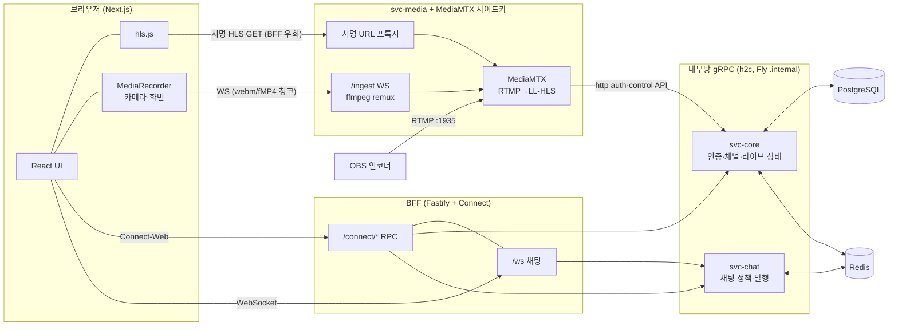

# Streamix

**gRPC 기반 실시간 방송 플랫폼 (Twitch-Clone)** — OBS/브라우저 카메라 송출 → LL-HLS 저지연 재생(glass-to-glass 1.3~2.2s) → 실시간 채팅까지, 마이크로서비스 모노레포로 구현하고 실 도메인에 배포한 풀스택 스트리밍 서비스.

- **라이브**: <https://streamix-web.vercel.app>
- **마스터 플랜**: [`작업계획서.md`](./작업계획서.md) · 개선: [`작업계획서-개선.md`](./작업계획서-개선.md) · 카메라 방송: [`작업계획서-카메라방송.md`](./작업계획서-카메라방송.md)

핵심 수치 (stage/prod 실측):

| 지표                  | 결과                                               | 목표                 | 근거                                            |
| --------------------- | -------------------------------------------------- | -------------------- | ----------------------------------------------- |
| glass-to-glass 지연   | **1.26~2.21s** (LL-HLS)                            | < 6s                 | 개선계획 G3 판정, 타임코드 프레임 대조          |
| 재생 시작             | 166ms(로컬)~2s(프록시)                             | < 3s                 | 〃                                              |
| 브라우저 인제스트 CPU | copy remux **0.008코어**                           | 트랜스코딩 대비 50%↓ | G1 판정 (베이스라인 1.148코어 → 99.3%↓)         |
| 채팅 팬아웃           | crowd p95 **119ms** @200VU, 슬로우 소비자 1개 격리 | p95 < 300ms          | G4 판정, k6 WS 리그                             |
| 보안 하드닝           | 정적 감사 **10차 리뷰 라운드** 대응 (P0 7건 포함)  | —                    | [§5.4](#54-보안-하드닝-p0p2--리뷰-라운드-v1v10) |

---

## 목차

1. [프로젝트 소개](#1-프로젝트-소개)
2. [기술 스택 전체 목록](#2-기술-스택-전체-목록)
3. [아키텍처](#3-아키텍처)
4. [기술 상세 기록](#4-기술-상세-기록)
   - [4.1 언어·런타임·모노레포](#41-언어런타임모노레포)
   - [4.2 프로토콜·계약 (gRPC / Connect / buf / Zod)](#42-프로토콜계약-grpc--connect--buf--zod)
   - [4.3 프론트엔드 (Next.js 15)](#43-프론트엔드-nextjs-15)
   - [4.4 BFF (Fastify + Connect)](#44-bff-fastify--connect)
   - [4.5 svc-core (인증·채널·라이브 상태)](#45-svc-core-인증채널라이브-상태)
   - [4.6 svc-chat (팬아웃)](#46-svc-chat-팬아웃)
   - [4.7 svc-media (RTMP → LL-HLS 미디어 평면)](#47-svc-media-rtmp--ll-hls-미디어-평면)
   - [4.8 데이터 계층 (PostgreSQL / Drizzle / Redis)](#48-데이터-계층-postgresql--drizzle--redis)
   - [4.9 인프라·배포 (Docker / Fly.io / Vercel / GitHub Actions)](#49-인프라배포-docker--flyio--vercel--github-actions)
   - [4.10 테스트·품질 도구](#410-테스트품질-도구)
5. [개발 여정 전수 기록](#5-개발-여정-전수-기록)
   - [5.1 Phase 0~6 — MVP 구축과 배포](#51-phase-06--mvp-구축과-배포)
   - [5.2 개선 트랙 M0~M5 — 인코딩 최적화·LL-HLS·팬아웃 견고화](#52-개선-트랙-m0m5--인코딩-최적화ll-hls팬아웃-견고화)
   - [5.3 카메라 방송 트랙 C1~C4 — 원클릭 Go Live](#53-카메라-방송-트랙-c1c4--원클릭-go-live)
   - [5.4 보안 하드닝 P0~~P2 + 리뷰 라운드 V1~~V10](#54-보안-하드닝-p0p2--리뷰-라운드-v1v10)
   - [5.5 ADR 결정 기록 목록](#55-adr-결정-기록-목록)
6. [온보딩 · 개발 가이드](#6-온보딩--개발-가이드)
7. [검증 철학 · 문서 인덱스](#7-검증-철학--문서-인덱스)

---

## 1. 프로젝트 소개

Twitch의 핵심 UX(라이브 목록 → 시청 + 채팅 → 방송 스튜디오)를 벤치마킹한 실시간 방송 플랫폼. 학습 목표는 **마이크로서비스 간 gRPC 통신 최적화**와 **실시간 미디어/채팅 파이프라인**이며, 완료 판정 기준을 "테스트 통과"가 아니라 **"실 도메인에서 실제 구동되는 스모크 통과"** 로 두고 진행했다.

주요 기능:

- 회원가입/로그인 (Argon2id + 회전형 refresh 세션 + jti denylist), Twitch OAuth 로그인
- 채널 생성, 스트림 키 발급·회전, 방송 시작/종료, 방송 제목 수정
- **OBS RTMP 송출** 및 **브라우저 송출**(화면 공유·카메라·모바일 카메라, 원클릭 Go Live)
- LL-HLS 저지연 재생 (hls.js) + **서명 URL 재생 인가** (무단 시청 차단)
- 채널별 실시간 채팅 (WebSocket, Redis Pub/Sub 팬아웃, 슬로우모드/밴)
- 라이브 목록 홈 (실시간 썸네일, 시청자 폴링)

전 구간이 배포되어 있다: web은 Vercel, BFF·백엔드·미디어는 Fly.io(도쿄 nrt, 내부 gRPC는 `.internal` 사설망), RTMP는 전용 TCP IP로 수신.

---

## 2. 기술 스택 전체 목록

> 각 항목의 **상세** 링크는 [§4 기술 상세 기록](#4-기술-상세-기록)의 해당 절로 이동한다.

### 언어 · 런타임 · 모노레포 — [상세 §4.1](#41-언어런타임모노레포)

| 기술                | 버전 | 역할                             |
| ------------------- | ---- | -------------------------------- |
| TypeScript (strict) | 5.7  | 전 워크스페이스 단일 언어        |
| Node.js             | ≥ 20 | 전 서비스 런타임                 |
| pnpm workspaces     | 9.15 | 패키지 매니저·워크스페이스       |
| Turborepo           | 2.3  | 태스크 파이프라인·빌드 캐시      |
| tsx                 | —    | dev 실행기 (`node --import tsx`) |

### 프로토콜 · 계약 — [상세 §4.2](#42-프로토콜계약-grpc--connect--buf--zod)

| 기술                                                                 | 역할                                                       |
| -------------------------------------------------------------------- | ---------------------------------------------------------- |
| gRPC / proto3 (HTTP/2 h2c)                                           | 내부 서비스 간 RPC 계약                                    |
| Connect (`@connectrpc/connect-web`·`connect-node`·`connect-fastify`) | 브라우저↔BFF RPC — 프록시 없는 gRPC 호환 (ADR-1)           |
| buf + `protoc-gen-es` (Connect-ES 2.0)                               | proto lint / breaking 검사 / 코드젠 (ADR-2)                |
| Zod                                                                  | 경계 입력 검증·환경변수 파싱 (`packages/schemas`·`config`) |
| WebSocket (`ws`, `@fastify/websocket`)                               | 채팅·브라우저 인제스트 양방향 스트림 (ADR-4)               |

### 프론트엔드 — [상세 §4.3](#43-프론트엔드-nextjs-15)

| 기술                                                         | 버전         | 역할                                      |
| ------------------------------------------------------------ | ------------ | ----------------------------------------- |
| Next.js (App Router)                                         | 15           | SSR 프레임워크                            |
| React                                                        | 19           | UI                                        |
| Tailwind CSS                                                 | 4            | 스타일                                    |
| hls.js                                                       | 1.5          | LL-HLS 재생 (MSE)                         |
| TanStack Query                                               | 5            | 서버 상태·폴링                            |
| Zustand                                                      | 5            | 인증 등 클라이언트 전역 상태              |
| React Hook Form + `@hookform/resolvers`                      | 7            | 폼 + Zod 검증                             |
| motion (framer-motion 후속)                                  | 11           | 애니메이션 (카드 스태거, 랜딩 cloth 물리) |
| geist / @phosphor-icons/react / clsx / tailwind-merge        | —            | 폰트·아이콘·클래스 유틸                   |
| MediaRecorder · getUserMedia/getDisplayMedia · Wake Lock API | 브라우저 API | 카메라/화면 캡처 송출                     |

### 백엔드 서비스 — [상세 §4.4](#44-bff-fastify--connect)~[§4.7](#47-svc-media-rtmp--ll-hls-미디어-평면)

| 기술                                             | 사용처                | 역할                                            |
| ------------------------------------------------ | --------------------- | ----------------------------------------------- |
| Fastify (+ `@fastify/cors`·`@fastify/websocket`) | bff                   | HTTP/WS 게이트웨이                              |
| jose                                             | bff·svc-core          | JWT (HS256, iss/aud/jti 검증)                   |
| argon2 (node-argon2)                             | svc-core              | Argon2id 비밀번호 해시                          |
| ioredis                                          | bff·svc-core·svc-chat | Redis 클라이언트 (Pub/Sub·세션·라이브 상태)     |
| prom-client                                      | bff                   | Prometheus 메트릭 (`/metrics`, 인증 보호)       |
| ffmpeg (`ffmpeg-static`)                         | svc-media             | 브라우저 인제스트 remux/트랜스코딩, 썸네일      |
| MediaMTX                                         | svc-media 사이드카    | RTMP 인제스트 → **진짜 LL-HLS** 패키징 (ADR-10) |

### 데이터 계층 — [상세 §4.8](#48-데이터-계층-postgresql--drizzle--redis)

| 기술                                             | 역할                                                          |
| ------------------------------------------------ | ------------------------------------------------------------- |
| PostgreSQL                                       | 영속 데이터 (users/channels/streams/follows)                  |
| Drizzle ORM (+ drizzle-kit, `postgres` 드라이버) | 타입세이프 쿼리·마이그레이션                                  |
| Redis                                            | 라이브 상태(SET NX·TTL)·세션·denylist·Pub/Sub·캐시·레이트리밋 |

### 인프라 · 배포 — [상세 §4.9](#49-인프라배포-docker--flyio--vercel--github-actions)

| 기술           | 역할                                                                                       |
| -------------- | ------------------------------------------------------------------------------------------ |
| Docker Compose | 로컬 인프라 (postgres·redis·minio·nginx·mediamtx)                                          |
| NGINX / MinIO  | 로컬 HLS 서빙 초안 / S3 호환 스토리지                                                      |
| Fly.io         | bff·svc-core·svc-chat·svc-media 컨테이너 4앱 + Postgres + Redis, RTMP 전용 TCP IP          |
| Vercel         | `apps/web` 호스팅 (SSR·CDN)                                                                |
| Cloudflare R2  | HLS CDN 오프로딩 (후속 최적화로 보류 — 현재 svc-media 직접 서빙)                           |
| GitHub Actions | CI (lint·typecheck·buf breaking·build·세션 통합 게이트) + CD (Fly/Vercel 배포·스모크·롤백) |

### 테스트 · 품질 — [상세 §4.10](#410-테스트품질-도구)

| 기술                                                   | 역할                                                  |
| ------------------------------------------------------ | ----------------------------------------------------- |
| Playwright                                             | 해피패스 E2E 1개 + 카메라 방송 fake-device 판정기     |
| Vitest                                                 | 크리티컬 패스 유닛 (argon2 게이트·세션·env fail-fast) |
| k6                                                     | 채팅 팬아웃 WS 부하·목록 API 부하 리그                |
| 구동 스모크 스크립트 (tsx)                             | 서비스별 `scripts/smoke-*.ts` — 1순위 검증 수단       |
| ESLint 9 + Prettier / husky + lint-staged + commitlint | 정적 품질·커밋 규약 (Conventional Commits)            |

---

## 3. 아키텍처

**제어 평면과 데이터 평면의 분리**가 설계의 축이다. API·채팅(텍스트)은 BFF를 경유하는 유일 진입점으로 흐르고, 영상 바이트는 gRPC에 절대 싣지 않고 BFF를 우회해 서명 URL로 직접 흐른다.



- **제어 평면**: 브라우저 → BFF(Connect-Web unary / WS) → 내부 gRPC(svc-core·svc-chat). BFF가 JWT 검증 후 `x-user-id` 등 유저 컨텍스트를 헤더로 전파하고, 서비스 간에는 내부 서비스 토큰 인증을 얹었다.
- **데이터 평면**: OBS(RTMP) 또는 브라우저(WS 인제스트) → MediaMTX(LL-HLS) → svc-media 서명 프록시 → hls.js. 재생 인가는 Core가 발급한 HMAC 서명 URL로 강제 — 무서명 요청은 403.
- **라이브 상태 단일 writer**: `live:{channelId}`는 svc-core만 기록한다(SET NX로 중복 송출 차단, TTL+heartbeat로 좀비 스트림 회수). LMAX Disruptor 검토에서 이 single-writer 원리만 채택했다(ADR-11).

모노레포 구조:

```
apps/
  web/        Next.js 15 프론트 (홈·watch·studio·login·랜딩)
  bff/        Fastify + Connect 게이트웨이, WS 채팅 종단, 세션·레이트리밋
  svc-core/   인증(Argon2id)·채널·스트림 키·라이브 상태 (gRPC :50051)
  svc-chat/   채팅 정책(슬로우모드·밴)·Redis publish (gRPC :50052)
  svc-media/  WS 인제스트(ffmpeg)·MediaMTX 라이프사이클·서명 HLS 프록시·썸네일·retention
packages/
  proto/      .proto 원본 + buf 코드젠 산출물 (공유 타입/클라이언트)
  schemas/    공유 Zod 스키마 + 에러 계약 상수
  config/     환경변수 Zod 파서
  db/         Drizzle 스키마·마이그레이션
infra/
  docker-compose.yml · mediamtx.yml · nginx/ · k6/ · fly/
```

에러는 단일 계약으로 통일했다: 도메인 에러 `AppErrorCode` → Connect 코드 매핑(예: `invalid_stream_key`→`permission_denied`), 채팅 WS는 4000번대 close code 규약(4001 미인증, 4008 레이트리밋, 4009 인제스트 backpressure 초과, 4409 중복 인제스트). [`docs/error-contract.md`](./docs/error-contract.md) 참조.

---

## 4. 기술 상세 기록

각 기술을 "무엇 → 어디에 → 왜 → 관련 결정/커밋" 순으로 기록한다.

### 4.1 언어·런타임·모노레포

- **TypeScript strict + Node.js ≥20** — 5개 앱·4개 패키지 전부 단일 언어. `tsc --noEmit`이 상시 계약 안전망이고, dev 실행은 `tsx`(esbuild 기반)로 빌드 없이 구동한다.
- **pnpm workspaces + Turborepo (ADR-7)** — 3개 백엔드 서비스 + BFF + 프론트가 `@streamix/proto`(생성 타입), `@streamix/schemas`(Zod·에러 계약), `@streamix/config`(env 파서), `@streamix/db`(Drizzle 스키마)를 공유해야 하므로 모노레포가 전제였다. `turbo run build`가 패키지 위상 순서를 관리하고 캐시한다. 부트스트랩 커밋 `89aedfb`.
- **husky + lint-staged + commitlint** — Conventional Commits 강제. 81개 커밋 전부가 `feat/fix/perf/docs/chore/test(scope)` 규약을 따라, §5의 여정 추적이 커밋 로그만으로 가능하다.

### 4.2 프로토콜·계약 (gRPC / Connect / buf / Zod)

- **gRPC / proto3** — 서비스 계약의 원천. `packages/proto/proto/{user,channel,chat,common}/v1/*.proto`에 4개 서비스가 정의되고, 내부 통신은 HTTP/2 h2c 위 gRPC 와이어 호환으로 흐른다.
- **Connect (ADR-1)** — 전통적 gRPC-Web은 Envoy 프록시가 필수라 기각하고, 브라우저에서 프록시 없이 직접 호출 가능한 Connect 프로토콜을 채택했다. 같은 `.proto`에서 브라우저(`connect-web`)·서버(`connect-node`) 코드를 함께 생성하고, gRPC와 와이어 호환이라 내부 최적화 목표를 훼손하지 않는다. 제약: 브라우저 fetch 트랜스포트는 unary+서버 스트리밍만 지원 → 양방향이 필요한 채팅·인제스트는 WebSocket으로 분리(ADR-4).
- **NestJS 계획 → Connect-Node 전환 (ADR-5 개정)** — 원계획은 NestJS gRPC 트랜스포트였으나, buf/`protoc-gen-es`(Connect-ES 2.0) 코드젠과 NestJS의 `@grpc/proto-loader` 런타임 로딩이 타입·툴체인 면에서 어긋나 **Connect-Node 직접 구현으로 전환**했다. 동일 코드젠 산출물을 서버·클라이언트가 공유하고 스캐폴딩이 가볍다.
- **buf (ADR-2)** — `buf lint`·`buf generate`·`buf breaking`(main 대비 파괴적 변경 감지)을 CI 하드 게이트로 운용(`a909d71`에서 승격). Connect-ES 2.0부터는 `protoc-gen-es` 단독이 메시지+서비스 코드를 모두 생성한다(1.x의 `protoc-gen-connect-es`는 폐기).
- **Zod** — proto와 중복이 아니라 **경계 검증 전담**: 브라우저 폼, BFF 입력, 환경변수(`packages/config` — production에서 dev 기본값·짧은 시크릿이면 기동 거부하는 fail-fast까지 포함, `8e378d0`). 에러 계약 상수(`AppErrorCode`, WS close code)도 `@streamix/schemas`에서 단일 소스로 공유한다.

### 4.3 프론트엔드 (Next.js 15)

- **Next.js 15 App Router + React 19** — 홈(라이브 그리드)·`/watch/[slug]`·`/studio`·로그인/가입·숨은 `/lab`(물리 튜닝) 페이지. Vercel 배포로 SSR·CDN을 취한다.
- **hls.js** — LL-HLS 재생. MSE 지원 브라우저는 hls.js를 우선하고 native HLS는 Safari 폴백만 — Chromium이 `canPlayType`에 "maybe"를 반환해 native로 오판하던 버그를 수정했다(`8963f50`). 방송 전 재생 준비 재시도, 오프라인↔라이브 자동 전환 폴링(`0340f19`) 포함.
- **TanStack Query** — 홈 `ListLive` 폴링·캐시. **Zustand** — 액세스 토큰을 **메모리에만** 보관하는 인증 스토어(+ 페이지 로드 시 refresh로 복원하는 하이드레이터). localStorage 토큰 저장을 의도적으로 배제한 보안 설계의 축.
- **React Hook Form + zodResolver** — 로그인/가입/방송 설정 3폼. 스키마는 서버와 공유.
- **motion** — 카드 그리드 스태거, 채팅 메시지 진입, `prefers-reduced-motion` 존중. 랜딩은 **캔버스 물리 기반 tearable cloth**(잡아 찢으면 로그인 스테이지가 드러나는 게이트, `45ce034`~`7637a74`) — 스프링 물리·자동 드롭 폴백까지 별도 튜닝 트랙을 거쳤다.
- **브라우저 미디어 API** — `getDisplayMedia`(화면)·`getUserMedia`(카메라) → MediaRecorder 500ms 청크 → WS `/ingest`. 코덱 3단 협상(`MediaRecorder.isTypeSupported`), 모바일은 facingMode 전환·세로 letterbox·Wake Lock·`pagehide` 정상 종료(§5.3). Chromium H.264 캡처가 non-seekable 파이프에서 디먹스 불가라는 실측 발견으로 webm-vp8 우선으로 확정했다.

### 4.4 BFF (Fastify + Connect)

역할: 외부 유일 제어 평면 진입점. Connect RPC 프록시 + REST 세션 라우트 + WS 채팅 종단.

- **Fastify + `@connectrpc/connect-fastify`** — Connect 서비스 프록시를 Fastify에 마운트. 내부 전용 RPC(채널 라이프사이클, OAuth upsert)는 브라우저 노출 차단.
- **jose 세션 모델** ([`docs/auth-session.md`](./docs/auth-session.md)) — access는 HS256 JWT(`typ`/`iss`/`aud`/`jti`/`fam` 클레임 검증, 15m), refresh는 **불투명 회전 토큰**을 HttpOnly `Path=/auth` 쿠키로만 전달. 회전·재사용 탐지는 **원자적 Redis Lua 스크립트**로, 그레이스(3s) 이후 재사용은 패밀리 전체 폐기 + `fam` 마커로 기발급 access 토큰까지 무효화. 로그아웃‖리프레시 동시성 race로 패밀리가 부활하지 않음을 스모크로 검증(21/21). CSRF는 커스텀 헤더 `x-sx-web` + CORS 오리진 allowlist로 차단.
- **WS 채팅 종단 (ADR-4)** — 룸별 refcount 구독(첫 조인 시 Redis 채널 구독, 마지막 이탈 시 해제). 인증 토큰은 URL 쿼리가 아니라 **첫 프레임**으로 수신(`923ba19`). 팬아웃 backpressure: `bufferedAmount` 1MB 초과 소켓은 skip + 드롭 카운터, 50ms 코얼레싱 배칭(leading-edge 즉시 flush) — 슬로우 소비자 1개가 나머지 999를 지연시키지 않는 구조(ADR-11 대체 작업).
- **레이트리밋** — Connect 인터셉터로 로그인 이메일당 5/30s, RPC IP당 300/10s, 채팅 send 5/3s. Fly 프록시 뒤 신뢰 프록시 설정으로 `x-forwarded-for` 위조 대응. Redis 다운 시 fail-open(가용성 우선).
- **prom-client** — `/metrics` 기본 메트릭 (인증 보호).

### 4.5 svc-core (인증·채널·라이브 상태)

- **argon2 (Argon2id, 64 MiB·t=3·p=4)** — 비밀번호 해시. 해시 연산은 **세마포어로 동시성 제한**해 회원가입 폭주로 인한 메모리 고갈 공격을 차단(V3-1 대응, 유닛 테스트 `8913f24`). 로그인 실패는 계정 존재 여부를 구분하지 않고, 더미 해시 검증으로 타이밍 편차도 방어(V5-1).
- **스트림 키** — 24 random bytes, DB에는 SHA-256 해시만 저장. prefix+발급시각만 조회 노출, 회전 가능(`2d471f0`). 브라우저 Go-Live는 별도 **단기 인제스트 토큰**(`bit_` prefix, Redis TTL 15m)으로 분리해 OBS 키 회전 풋건을 제거(ADR-13).
- **라이브 상태 단일 writer** — `SET NX`(중복 송출 거부) + TTL + heartbeat RPC(좀비 회수) + 첫 세그먼트 확인 후 노출. 채팅 룸 조인 시 채널 존재 게이트로 임의 UUID 룸/구독 고갈 차단(`b46b896`).
- **Twitch OAuth** — BFF confidential-client 플로우로 로그인(`e225c07`).

### 4.6 svc-chat (팬아웃)

메시지 핫패스의 **정책 판정 + 발행** 전담: 슬로우모드·밴 판정 후 Redis Pub/Sub publish. WS 종단·릴레이는 BFF 소관으로 책임을 분리해(ADR-4) svc-chat이 불필요한 홉이 되지 않게 했다. Join은 Connect 서버 스트리밍. k6 실측: 100 동시 클라이언트에서 139,795 메시지(3,852/s) 정상 분산.

### 4.7 svc-media (RTMP → LL-HLS 미디어 평면)

미디어 평면의 진화가 이 프로젝트의 가장 큰 기술 서사다.

- **1기: Node-Media-Server + ffmpeg 표준 HLS** (`8b54dc8`) — RTMP 수신 → `-c copy` 패키징(`hls_time=2`). g2g 실측 7.5~9.1s로 목표(<6s) 미달 — "수용된 편차"로 기록 후 개선 트랙 개설.
- **2기: MediaMTX LL-HLS (ADR-10)** (`3fe612c`) — ffmpeg hls muxer는 진짜 LL-HLS(`#EXT-X-PART`·blocking playlist reload) 미지원, SRS도 미구현임을 사실 검증으로 확정 → 패키저를 MediaMTX로 교체. 스파이크 게이트에서 g2g ~1.45s 실측 후에만 착수. scratch 이미지라 셸 훅이 불가해 스트림키 검증은 **http auth 콜백**, 라이프사이클은 **control API 폴링**으로 구현. Fly에서는 svc-media와 같은 머신의 사이드카로 기동.
- **브라우저 인제스트 (ADR-9)** — MediaRecorder 청크를 WS로 수신해 ffmpeg로 로컬 RTMP publish. 코덱 협상 3분기: fMP4 H.264+AAC는 풀 copy(인코딩 0), webm-h264는 비디오 copy+AAC 변환, 그 외 VP8은 libx264 트랜스코딩 폴백. copy 경로가 CPU를 99.3% 절감(1.148→0.008코어). 트랜스코딩엔 레이트 컨트롤(`-maxrate 2500k`)과 fps 무관 2s 키프레임(`-force_key_frames`)을 강제해 비트레이트 17배 폭주(668k↔11.2Mbps)와 세그먼트 길이 요동을 해결. `writableLength` 상한(기본 64MB) 초과 시 4009로 종료하는 인제스트 backpressure 포함.
- **서명 URL 재생 인가** — Core가 HMAC 서명 URL 발급(`GetPlaybackUrl`), svc-media 프록시가 검증(`timingSafeEqual`) 후 MediaMTX로 리버스 프록시. LL-HLS 태그(`EXT-X-PART`/`MAP`/`PRELOAD-HINT`)의 토큰 재작성, blocking reload 파라미터 통과, 세그먼트 스트리밍 파이프. 무서명 403은 전 라운드 회귀 스모크로 고정.
- **썸네일·retention** — 초기 RTMP 재연결 캡처 → HLS 세그먼트에서 직접 1프레임 추출로 경량화(`f63ff72`). 종료 grace reap + 주기 스윕으로 세그먼트/썸네일 TTL 정리.

### 4.8 데이터 계층 (PostgreSQL / Drizzle / Redis)

- **PostgreSQL (ADR-6)** — users·channels·streams·follows. 관계·트랜잭션이 명확한 도메인이라 문서형 DB 대신 확정. 마이그레이션은 drizzle-kit, prod 적용은 배포 워크플로의 **migration-first 게이트**(V7-1 대응)로 순서 보장. 이메일 canonicalization은 기존 계정 충돌을 피하려 DB 마이그레이션과 함께 적용(V6-3).
- **Drizzle ORM** — 타입세이프·경량(Prisma의 엔진 바이너리 의존 회피). 스키마가 곧 타입 소스.
- **Redis** — 단일 인스턴스가 5개 평면을 겸한다: 라이브 상태(SET NX·TTL), refresh 세션·jti denylist(Lua 원자 연산), 채팅 Pub/Sub, 목록 캐시, 레이트리밋 카운터. SPOF임을 인지하고 **장애 주입으로 폴백을 실증**했다: Redis 다운 시 ListLive는 Postgres `streams.status` 폴백, 채팅은 unavailable close(비크래시), 레이트리밋 fail-open, 재기동 시 자동 복구(`ba2fabf`).

### 4.9 인프라·배포 (Docker / Fly.io / Vercel / GitHub Actions)

- **Docker Compose** — 로컬 원커맨드 기동: postgres·redis·minio·nginx + MediaMTX dev 사이드카.
- **Fly.io (ADR-8)** — 4앱(bff·core·chat·media) + Fly Postgres + 자체 Redis 앱. 내부 gRPC는 `.internal` 사설망. RTMP는 raw TCP 1935가 필요해 전용 IPv4 할당 — 이 제약이 Railway 대신 Fly를 고른 결정 근거. 비용 최소화로 bff·media는 min=0 + suspend 자동 기동(콜드스타트 수용 편차).
- **Vercel** — `apps/web`. 루트 `vercel.json`으로 워크스페이스 install + proto/web 빌드. `NEXT_PUBLIC_*`만 노출하고 시크릿은 전부 Fly secrets로 분리.
- **Cloudflare R2** — HLS egress 절감용으로 계획(ADR-8)했으나 현재는 svc-media 직접 서빙으로 충분해 후속 최적화로 보류.
- **GitHub Actions** — CI: lint → typecheck → `buf lint`/`buf breaking` → build → 세션 통합 게이트(`998b768`). CD: main 머지 시 migration-first로 Fly/Vercel 배포 + 실 도메인 스모크 + 실패 시 롤백. 공급망 하드닝: 액션·이미지 태그 고정, `FLY_API_TOKEN` 노출 범위 축소, `vercel` CLI 버전 고정(`59ac85c`, V8/V9 대응).
- **크로스오리진** — web(vercel.app)과 BFF(fly.dev)가 다른 오리진이라 CORS allowlist, WS Origin 검증, refresh 쿠키 `SameSite=None; Secure`, 재생 인가는 토큰-in-URL(쿠키 불요)로 마감.

### 4.10 테스트·품질 도구

검증 철학([§7](#7-검증-철학--문서-인덱스))에 따라 자동 테스트는 얇고, 구동 스모크가 1순위다.

- **구동 스모크 (tsx 스크립트)** — 각 서비스 `scripts/smoke-*.ts`: 인증 13종, 채팅 5종, BFF E2E 7종, 미디어 서명/인제스트/토큰, 세션 21종(동시 리프레시 20-way·재사용 탐지·패밀리 폐기), prod 타깃 스모크까지. 완료 판정의 실질 근거.
- **Playwright** — 필수 자동 E2E는 해피패스 1개(로그인→목록→시청→채팅, 결정적 시드 픽스처). 카메라 방송은 `--use-fake-device-for-media-stream`으로 C1~C4 판정기를 겸하는 스크립트 1개(`camera-broadcast.mts`, SOURCE/MOBILE 파라미터).
- **Vitest** — 크리티컬 패스만: argon2 동시성 게이트, 세션 회전/폐기 스트레스, production env fail-fast.
- **k6** — 채팅 팬아웃 WS 리그(슬로우 클라이언트 주입 시나리오 포함), 목록 API 부하. 결과는 `infra/k6/RESULTS.md`.
- **Lighthouse** — 접근성 게이트 ≥90 (login 96 / home 95 통과, 저대비 텍스트 수정).

---

## 5. 개발 여정 전수 기록

81개 커밋 전체를 4개 트랙으로 추적한다. 모든 단계는 pass/fail 게이트(DoD)로 닫혔고, 미달 항목은 "수용된 편차"로 근거와 함께 문서화됐다.

### 5.1 Phase 0~6 — MVP 구축과 배포

| Phase           | 내용                                                                                           | 주요 커밋                               | 게이트 결과                                          |
| --------------- | ---------------------------------------------------------------------------------------------- | --------------------------------------- | ---------------------------------------------------- |
| 0 부트스트랩    | pnpm+Turbo 모노레포, buf 코드젠, compose 인프라, CI, 배포 뼈대(Dockerfile·fly.toml)            | `89aedfb` `68cd028`                     | CI 그린, compose 헬스 통과                           |
| 1 계약 정의     | Drizzle 스키마, proto v1 4종, **에러 계약 선행 확정**, web 셸                                  | `bdf19ef` `e200ba1`                     | 마이그레이션 up/down, proto 컴파일                   |
| 2 백엔드 핵심   | svc-core 인증/채널(스모크 13), svc-chat 팬아웃/모더레이션(5), BFF 게이트웨이+WS(7), 레이트리밋 | `c6ca645` `dfedc0d` `b582eaf` `41d818e` | 전 스모크 실구동 통과                                |
| 3 미디어+실시간 | RTMP→HLS 파이프라인, 서명 재생 URL(무서명 403), hls.js 플레이어, 채팅 프론트, 썸네일·retention | `8b54dc8` `71667ab` `8963f50` `3d93686` | ⚠️ g2g 6~10s **수용 편차** (→ §5.2에서 해소)         |
| 4 UI/UX         | 실 ListLive 홈·사이드바, RHF+Zod 폼, Zustand, 모션, 해피패스 E2E, a11y                         | `8676a29` `93fd5e0` `5d1992d` `711d1d4` | E2E 1 passed, Lighthouse a11y 95~96                  |
| 5 부하·안정화   | k6 리그(100클라 139,795msg), Redis 장애 주입 폴백 실증, 에러 계약 마감, buf breaking CI 승격   | `ba2fabf` `b795f75` `a909d71`           | 목록 p95 124ms·팬아웃 p95 343ms(수용 편차), 무크래시 |
| 6 배포          | Vercel + Fly 4앱 + Postgres/Redis 프로비저닝, RTMP 전용 IP, CORS 마감, 시크릿 분산             | `5b42854` `49b83e9` `9869789`           | 실 도메인 F1~F6 스모크 통과                          |

배포 후속: 오프라인→라이브 자동 전환(`0340f19`), 브라우저 화면 공유 송출 + 스트림 키 회전(`78727ca`), HLS 웜업 race 수정(`aa46501`).

### 5.2 개선 트랙 M0~M5 — 인코딩 최적화·LL-HLS·팬아웃 견고화

측정 우선 원칙: M0에서 베이스라인([`docs/perf-baseline.md`](./docs/perf-baseline.md))을 먼저 확보하고, 모든 게이트를 "대비 수치"로 판정했다. 실행은 [`KICKOFF.md`](./KICKOFF.md)의 병렬 서브에이전트 트랙(T-A 인제스트 / T-B 패키징 / T-C 팬아웃)으로 진행.

| 마일스톤                      | 내용                                                                           | 커밋                          | 게이트 판정                                    |
| ----------------------------- | ------------------------------------------------------------------------------ | ----------------------------- | ---------------------------------------------- |
| M0 측정                       | g2g 7.5/9.1s, CPU 0.365/1.148코어, 비트레이트 17배 폭주 정량화                 | `9ededb5`                     | 베이스라인 문서화                              |
| M1 레이트 컨트롤              | `-maxrate 2500k`·fps 무관 2s 키프레임·48kHz                                    | `7284f68`                     | **G2 PASS** (+2.6%, ±10% 내)                   |
| M2 코덱 협상 remux (ADR-9)    | 3단 협상 + copy 분기                                                           | `00ba338`                     | **G1 PASS** (97.8~99.3%↓)                      |
| M3 LL-HLS 전환 (ADR-10)       | MediaMTX 스파이크 게이트 → 마이그레이션 → 서명 프록시 LL-HLS 대응 → stage 배포 | `1fa049d` `3fe612c` `48d2a78` | **G3 PASS** (g2g 1.26~2.21s)                   |
| M4 backpressure (ADR-11 대체) | 팬아웃 skip+배칭, 인제스트 상한 4009                                           | `ee35009` `a832618`           | **G4 편차 수용**(격리 요건 통과) / **G5 PASS** |
| M5 후속                       | 썸네일 세그먼트 추출, 프록시 스트리밍                                          | `f63ff72` `c6b0d8b`           | stage 재검증 완료                              |

### 5.3 카메라 방송 트랙 C1~C4 — 원클릭 Go Live

`/loop` 무인 자동 실행 규약(사용자 입력 대기 금지, 보류 레지스터)으로 완주한 트랙. ADR-12(기존 WS 인제스트 재사용, WHIP 기각)·ADR-13(단기 인제스트 토큰)·ADR-14(카메라 전환=정지 후 재시작).

| 게이트              | 내용                                                       | 커밋      | 판정                                        |
| ------------------- | ---------------------------------------------------------- | --------- | ------------------------------------------- |
| C1 데스크톱 카메라  | BroadcastPanel 통합(카메라/화면·장치 선택·미리보기)        | `2861367` | **PASS** (prod fake-device 해피패스)        |
| C2 재발급 없는 시작 | `IssueIngestToken`(bit_ 토큰, Redis TTL 15m) — OBS 키 불변 | `271db0e` | **PASS** (위조 무효·rotate 독립성 포함)     |
| C3 모바일 방송      | facingMode 전환·세로 letterbox·Wake Lock·배경 배너         | `21787fb` | **PASS** (Pixel 5 에뮬레이션, 실기기 보류)  |
| C4 prod 배포        | UpdateChannel RPC·중복 인제스트 4409 가드·전 서비스 재배포 | `e4b4437` | **PASS** (camera/mobile/screen + 회귀 그린) |

핵심 발견(R1): Chromium MediaRecorder의 H.264 출력(fMP4·webm+h264)은 non-seekable 파이프에서 ffmpeg 디먹스 실패("moov atom not found") — 데스크톱도 해당. 브라우저 인제스트는 webm-vp8 우선으로 확정(`414c714`), H.264 copy는 OBS RTMP 경로만.

### 5.4 보안 하드닝 P0~~P2 + 리뷰 라운드 V1~~V10

외부 정적 감사([`inbox/review.md`](./inbox/review.md), P0 3건·P1 5건·P2 5건)를 받고, **수정 → 재검증 피드백(V-라운드) → 재수정**을 10차까지 반복했다. 대응 상세는 [`outbox/report.md`](./outbox/report.md).

| 라운드    | 핵심 조치                                                                                                                                                                                                                                                                                                         | 커밋      |
| --------- | ----------------------------------------------------------------------------------------------------------------------------------------------------------------------------------------------------------------------------------------------------------------------------------------------------------------- | --------- |
| P0        | 구형 Connect Login/Refresh 공개 차단(세션 모델 우회 제거), refresh 회전 Lua 원자화+재사용 탐지, register 레이트리밋(Argon2 자원 고갈 방어)                                                                                                                                                                        | `b9e3af0` |
| P1        | 패밀리 단위 access 토큰 폐기(`fam` 마커), 인제스트 pre-auth 상한, trusted proxy, 로그 redaction                                                                                                                                                                                                                   | `eb6d93c` |
| V1        | grace 60s→3s, JWT `iss`/`aud`/`typ` 검증, 전역 인증 동시성 상한, prod SameSite 강제                                                                                                                                                                                                                               | `372acae` |
| P2        | WS origin·자원 상한, 보안 헤더, `/metrics` 인증, 문서 정합성                                                                                                                                                                                                                                                      | `25e1379` |
| V2/V3     | 로그아웃‖리프레시 race의 패밀리 부활 차단(원자 revoke+durable 마커), Argon2 세마포어를 core로 이동                                                                                                                                                                                                                | `95a1b88` |
| —         | CI 세션 통합 게이트, 인제스트 핸드셰이크 가드, 계정 정책                                                                                                                                                                                                                                                          | `998b768` |
| V4~V6     | 로그인 타이밍 방어(더미 해시), 이메일 canonicalization 마이그레이션, WS 인증 대기 소켓 상한                                                                                                                                                                                                                       | `4a28d84` |
| V7        | 배포 워크플로 migration-first 게이트, 인제스트 origin allowlist 엄격화                                                                                                                                                                                                                                            | `b5f7204` |
| V4-1/V7-6 | 채팅 룸 채널 존재 게이트(임의 UUID 구독 고갈 차단)                                                                                                                                                                                                                                                                | `b46b896` |
| V8/V9     | 배포 공급망: 액션·이미지 핀 고정, 토큰 스코프 축소                                                                                                                                                                                                                                                                | `59ac85c` |
| 병행      | 내부 서비스 간 토큰 인증(`f07ea62`), CSP report-only(`037084f`), WS 토큰 첫 프레임 이동(`923ba19`), 브라우저 인제스트에 영구 스트림키 거부(`7d093eb`), HLS 응답 no-referrer/nosniff(`10365ea`), argon2 게이트·세션 스트레스 테스트(`8913f24`), env fail-fast(`8e378d0`), prod 의존성 어드바이저리 해소(`6b9c003`) |           |

### 5.5 ADR 결정 기록 목록

| ADR | 결정                                              | 비고                      |
| --- | ------------------------------------------------- | ------------------------- |
| 1   | 브라우저 RPC = Connect (gRPC-Web+Envoy 기각)      | 프록시 제거               |
| 2   | proto 거버넌스 = buf + `protoc-gen-es` 단독       | Connect-ES 2.0            |
| 3   | 미디어 = RTMP → LL-HLS (WebRTC는 선택지로만)      | 영상 바이트는 gRPC 금지   |
| 4   | 채팅 = WS + Redis Pub/Sub, BFF/Chat 책임 분리     | 룸별 refcount 구독        |
| 5   | 백엔드 NestJS → **Connect-Node로 개정**           | 코드젠 툴체인 정합        |
| 6   | PostgreSQL + Drizzle, Redis, S3 호환 스토리지     |                           |
| 7   | pnpm workspaces + Turborepo                       |                           |
| 8   | 하이브리드 배포: Vercel + Fly.io + R2             | RTMP TCP가 Fly 결정 근거  |
| 9   | 브라우저 인제스트 코덱 협상 + copy remux          | 트랜스코딩은 폴백         |
| 10  | LL-HLS 패키저 = MediaMTX (NMS+ffmpeg 대체)        | 스파이크 게이트 후 착수   |
| 11  | **LMAX Disruptor 반려** → backpressure+배칭       | single-writer 원리만 채택 |
| 12  | 카메라 = 기존 MediaRecorder→WS 재사용 (WHIP 기각) |                           |
| 13  | Go-Live = 단기 인제스트 토큰 (OBS 키 분리)        | rotate 풋건 제거          |
| 14  | 방송 중 카메라 전환 = 정지 후 자동 재시작         |                           |

---

## 6. 온보딩 · 개발 가이드

### 로컬 개발

```bash
pnpm install
pnpm proto:gen                                      # buf 코드젠 (packages/proto/src/gen)
docker compose -f infra/docker-compose.yml up -d    # postgres/redis/minio/nginx/mediamtx
pnpm build
pnpm --filter @streamix/db db:migrate
pnpm --filter @streamix/bff dev                     # http://localhost:8080/health
pnpm --filter @streamix/web dev                     # http://localhost:3000
```

dev 포트: web 3000 · bff 8080 · svc-core 50051 · svc-chat 50052 · svc-media 1935(RTMP)/8090(HTTP).

### 주요 스크립트

| 명령                                                       | 역할                            |
| ---------------------------------------------------------- | ------------------------------- |
| `pnpm build` / `pnpm dev` / `pnpm typecheck` / `pnpm lint` | turbo 파이프라인                |
| `pnpm proto:gen` / `proto:lint` / `proto:breaking`         | buf 코드젠·계약 검사            |
| `pnpm --filter @streamix/web e2e`                          | Playwright 해피패스             |
| `apps/*/scripts/smoke-*.ts`                                | 서비스별 구동 스모크 (tsx 실행) |
| `infra/k6/*.js`                                            | 부하 리그                       |

### OBS 권장 설정

OBS(RTMP) 경로는 재인코딩 없이(`-c copy` 동등) 패키징되므로 세그먼트 분할이 송출 측 키프레임 간격에 종속된다:

- **키프레임 간격: 2초** (0/자동 금지 — 세그먼트 길이가 흔들린다)
- **레이트 컨트롤: CBR** (시청자 버퍼링 방지)

브라우저 송출은 서버가 자동 적용한다(트랜스코딩 시 `INGEST_VIDEO_BITRATE` 기본 `2500k`).

### 배포

하이브리드(ADR-8): web=Vercel · 백엔드/미디어=Fly.io. 배포 설정(Dockerfile·fly.toml·`.github/workflows/deploy.yml`)은 리포에 포함. 절차·시크릿·MediaMTX 사이드카 구성은 [`docs/DEPLOY.md`](./docs/DEPLOY.md).

---

## 7. 검증 철학 · 문서 인덱스

**완료 판정 = 테스트 통과가 아니라 실제 구동/배포 스모크.** 자동 테스트는 크리티컬 패스(인증·스트림키·팬아웃·재생 인가) 회귀 방어에만 얇게 쓰고 커버리지 목표를 두지 않는다. 대신 `tsc(strict)`·`buf breaking`·CI 그린을 상시 계약 안전망으로, 실 도메인 배포 스모크를 최종 게이트로 삼는다. (작업계획서 §9)

| 문서                                                                              | 내용                                                        |
| --------------------------------------------------------------------------------- | ----------------------------------------------------------- |
| [`작업계획서.md`](./작업계획서.md)                                                | 마스터 플랜: ADR-1~~8, WBS Phase 0~~6, NFR, 리스크 레지스터 |
| [`작업계획서-개선.md`](./작업계획서-개선.md)                                      | 개선 트랙: ADR-9~~11, M0~~M5, 게이트 G1~G5 판정             |
| [`작업계획서-카메라방송.md`](./작업계획서-카메라방송.md)                          | 카메라 방송: ADR-12~~14, C1~~C4, 무블로킹 루프 규약         |
| [`KICKOFF.md`](./KICKOFF.md)                                                      | 개선 트랙 병렬 서브에이전트 실행 구성                       |
| [`docs/auth-session.md`](./docs/auth-session.md)                                  | 세션 모델: 토큰 설계, 회전·재사용 탐지, CSRF, SameSite      |
| [`docs/error-contract.md`](./docs/error-contract.md)                              | AppErrorCode→Connect 코드, WS close-code 규약               |
| [`docs/bff-service-comm.md`](./docs/bff-service-comm.md)                          | 평면 분리, 내부 gRPC 규약, 포트                             |
| [`docs/perf-baseline.md`](./docs/perf-baseline.md)                                | M0 성능 베이스라인 (CPU/비트레이트/g2g 재현 커맨드)         |
| [`docs/DEPLOY.md`](./docs/DEPLOY.md)                                              | 배포 절차 (Fly/Vercel/시크릿/MediaMTX 사이드카)             |
| [`inbox/review.md`](./inbox/review.md) / [`outbox/report.md`](./outbox/report.md) | 보안 감사 원문 / 라운드별 대응 보고                         |
