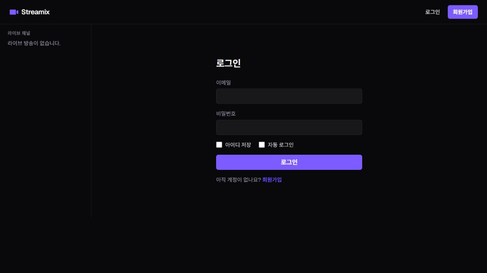
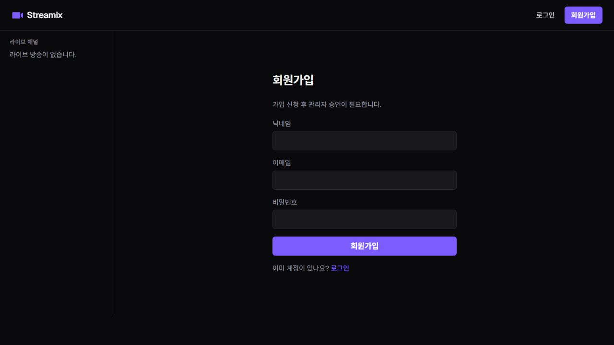
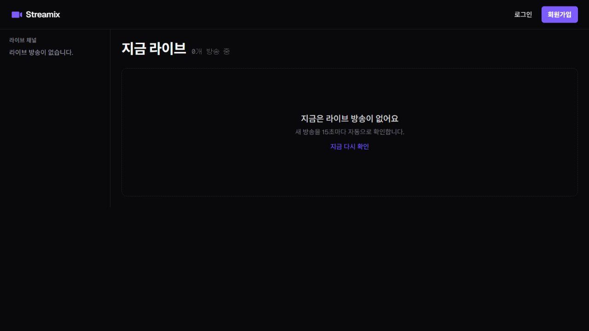
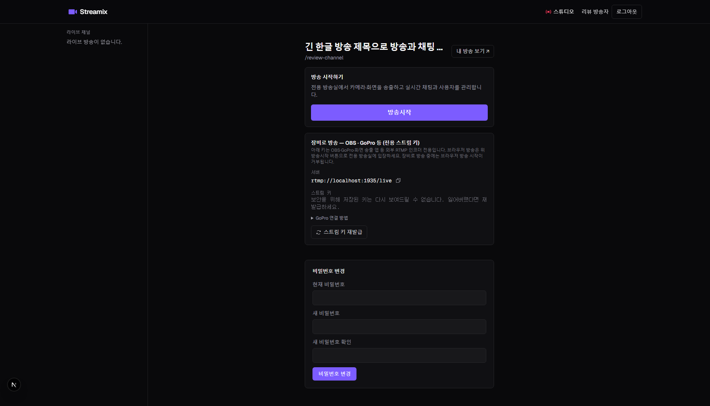
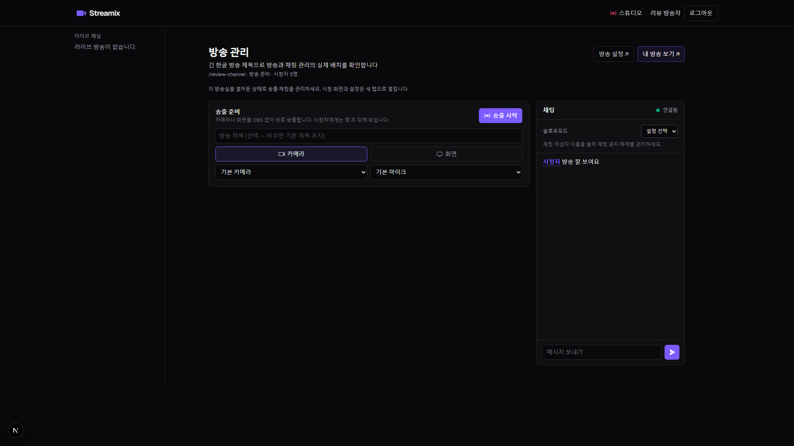
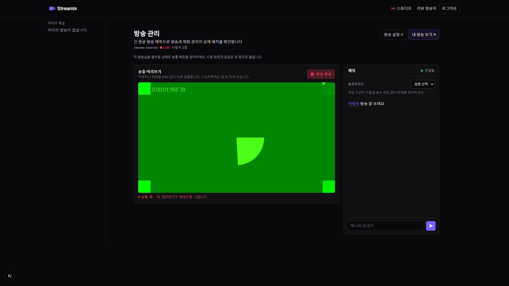

# Streamix

Streamix는 브라우저와 OBS에서 송출하고, 시청자가 라이브 영상과 실시간 채팅을 이용할 수 있는 스트리밍 플랫폼입니다.

[라이브 데모](https://streamix-web.vercel.app) · [화면 미리보기](#화면-미리보기) · [아키텍처](#아키텍처-요약) · [로컬 개발](#로컬-개발)

- **송출** — 브라우저 카메라·화면 공유 또는 OBS의 RTMP 입력
- **시청** — 라이브 채널 목록, LL-HLS 재생, 실시간 채팅
- **방송 관리** — 방송 스튜디오에서 송출과 채팅 관리

## 화면 미리보기

### 첫 화면


### 로그인과 회원가입

| 로그인 | 회원가입 |
| --- | --- |
|  |  |

### 라이브 목록



### 방송 스튜디오

아래 세 장은 로컬 테스트에서 캡처했습니다. 송출 중 미리보기에는 테스트 영상이 표시됩니다.

| 방송 설정 | 송출 준비와 채팅 |
| --- | --- |
|  |  |



## 아키텍처 (요약)

- **제어 평면**: 브라우저 → BFF(Connect-Web/WS) → 내부 gRPC(`svc-core`/`svc-chat`)
- **데이터 평면**: OBS(RTMP) → `svc-media`(LL-HLS) → R2/CDN → `hls.js` (BFF 우회, 서명 URL)
- **배포(ADR-8)**: web=Vercel · 백엔드·미디어=Fly.io · HLS=Cloudflare R2

## 모노레포

```
apps/       web · bff · svc-core · svc-chat · svc-media
packages/   proto · schemas · config
infra/      docker-compose · nginx
```

## 로컬 개발

```bash
pnpm install
pnpm proto:gen                 # buf 코드젠 (packages/proto/src/gen)
docker compose -f infra/docker-compose.yml up -d   # postgres/redis/minio/nginx
pnpm build
pnpm --filter @streamix/bff dev  # http://localhost:8080/health
```

### OBS 권장 설정

OBS(RTMP) 경로는 서버에서 `-c copy`로 재인코딩 없이 패키징하므로, 세그먼트 분할이 송출 측 키프레임 간격에 종속된다. `hls_time=2`(2초 세그먼트)와 정렬하려면 OBS에서:

- **키프레임 간격(Keyframe Interval): 2초** (0/자동 금지 — 세그먼트 길이가 흔들린다)
- **레이트 컨트롤: CBR** (시청자 버퍼링 방지)

브라우저 송출 경로는 서버가 위 값을 자동 적용한다(트랜스코딩 시 `INGEST_VIDEO_BITRATE` 기본 `2500k`).

## 배포

하이브리드(ADR-8): web=Vercel · 백엔드/미디어=Fly.io · HLS=R2. 배포 설정(Dockerfile·fly.toml·`.github/workflows/deploy.yml`)은 리포에 포함. 실행 절차는 [`docs/DEPLOY.md`](./docs/DEPLOY.md).

## 검증 철학

완료 판정 = **테스트 통과가 아니라 실제 구동/배포 스모크**. 자동 테스트는 크리티컬 패스 회귀 방어에만 얇게. (§9)
